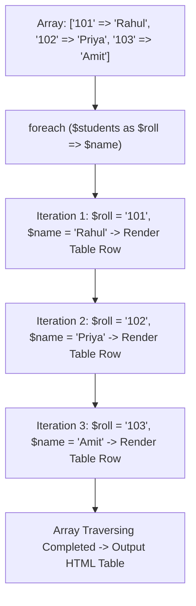

# Class 27: PHP Iteration Loops (`while`, `for`, `foreach`), Array Processing & Script Exit Statements

**Course:** Web Technology & Cloud Computing Applications – I  
**Unit:** Unit V - Server-Side Scripting & PHP Essentials: Basics, Forms & Databases  
**Target Duration:** 2 Hours (120 Minutes Continuous Session)  
**Self-Study Guide:** Designed for complete self-study. Every technical term is explained with simple real-world analogies without omitting any technical depth.

---

## 1. Class Session Objectives
By reading and studying this lecture guide line-by-line, you will be able to:
1. Construct PHP iteration loops: `while`, `do-while`, `for`, and `foreach`.
2. Differentiate between Indexed Arrays, Associative Arrays (Key-Value pairs), and Multidimensional Arrays in PHP.
3. Traverse arrays efficiently using `foreach ($array as $key => $value)` syntax.
4. Control script execution flow using `break`, `continue`, `exit()`, and `die()`.

---

## 2. Recommended 2-Hour Time Allocation

| Time Range | Duration | Activity / Teaching Strategy |
|---|---|---|
| **00:00 - 00:20** | 20 Mins | **Recap & Hook:** Review PHP operators. Demonstrate dynamically rendering an HTML `<table>` from a PHP array using `foreach`. |
| **00:20 - 00:50** | 30 Mins | **Deep Dive Theory:** Indexed vs Associative arrays, `foreach` loop syntax, `exit()` vs `die()` termination, loop HTML generation. |
| **00:50 - 01:20** | 30 Mins | **Visual Diagram Breakdown:** Associative Array Key-Value Memory Diagram & Foreach Loop Iteration Flow. |
| **01:20 - 01:45** | 25 Mins | **Live Code Walkthrough:** Building a dynamic student mark-sheet table generator using nested `foreach` loops. |
| **01:45 - 02:00** | 15 Mins | **Spot Quiz & Session Wrap-Up:** Student quiz questions, Next Class Teaser. |

---

## 3. Visual Flowcharts & Architectural Diagrams

### A. Foreach Loop Traversing an Associative Array


---

## 4. Key Jargon & Beginner Vocabulary Dictionary

> [!NOTE]
> * **Indexed Array:** An array where items are accessed using numerical index positions starting from 0 (e.g., `$colors[0]`).
> * **Associative Array:** An array where data items are stored as key-value pairs, using named string keys instead of numbers (e.g., `$student['name'] = 'Rahul'`).
> * **`foreach` Loop:** A specialized iteration loop in PHP designed specifically for traversing arrays without requiring manual counter variables.
> * **`exit()` / `die()`:** Built-in PHP functions used to immediately terminate script execution and output a final message.

---

## 5. In-Depth Topic Breakdown

### 5.1 Real-World Array & Foreach Analogies

1. **Indexed vs Associative Arrays (Numbered Mail Slots vs Named Cubbies):**
   * **Indexed Array (`$list[0]`):** Like numbered PO Boxes in a post office (`Box 0`, `Box 1`, `Box 2`). You ask for whatever letter is inside Box 0.
   * **Associative Array (`$list['name']`):** Like labeled cubbies in a preschool classroom. Each cubby has a student's name on it (`'name'`, `'roll'`, `'grade'`). You look up a value by its named key!
2. **`foreach` Loop (The Mail Carrier Delivering Letters):**
   * Imagine a mail carrier walking down a row of cubbies. He picks up each cubby envelope one by one (**Key $\rightarrow$ Value**), places it into an HTML table row, and moves to the next cubby automatically until all cubbies are visited!

---

### 5.2 PHP Array Types Summary Table

| Array Type | Syntax Example | Access Method | Best Use Case |
|---|---|---|---|
| **Indexed Array** | `$courses = array("HTML", "CSS", "PHP");` | `$courses[0]` | Simple ordered item lists |
| **Associative Array** | `$student = array("name" => "Rahul", "marks" => 85);` | `$student["name"]` | Structured database records |
| **Multidimensional Array** | `$grid = array(array(1, 2), array(3, 4));` | `$grid[0][1]` | Multi-row database result sets |

---

## 6. Practical Code Examples

### A. Rendering HTML Table via `foreach` Loop Script

```php
<?php
// Class 27 - PHP Loops & Array Processing Script

// 1. Associative Array of Student Records
$studentRoster = array(
    array("roll" => 101, "name" => "Rahul Sharma", "stream" => "SACS", "marks" => 88),
    array("roll" => 102, "name" => "Priya Patel",  "stream" => "BCC",  "marks" => 92),
    array("roll" => 103, "name" => "Amit Kumar",   "stream" => "SACS", "marks" => 76)
);

// Check if array is empty
if (empty($studentRoster)) {
    die("<p style='color:red;'>No student records found. Script terminated.</p>");
}
?>

<!DOCTYPE html>
<html lang="en">
<head>
    <meta charset="UTF-8">
    <title>PHP Dynamic Table Generator</title>
    <style>
        table { width: 80%; margin: 20px auto; border-collapse: collapse; font-family: Arial; }
        th, td { padding: 10px; border: 1px solid #ccc; text-align: left; }
        th { background: #003366; color: white; }
        tr:nth-child(even) { background: #f9f9f9; }
    </style>
</head>
<body>

    <h2 style="text-align:center;">BCA Student Roster (PHP Dynamic Foreach Loop)</h2>

    <table>
        <thead>
            <tr>
                <th>Roll No</th>
                <th>Student Name</th>
                <th>Stream</th>
                <th>Marks</th>
            </tr>
        </thead>
        <tbody>
            <?php
            // 2. Foreach Loop traversing Multidimensional Array
            foreach ($studentRoster as $student) {
                echo "<tr>";
                echo "<td>" . $student['roll'] . "</td>";
                echo "<td>" . htmlspecialchars($student['name']) . "</td>";
                echo "<td>" . $student['stream'] . "</td>";
                echo "<td>" . $student['marks'] . "</td>";
                echo "</tr>";
            }
            ?>
        </tbody>
    </table>

</body>
</html>
```

#### Line-by-Line Code Breakdown:
1. `$studentRoster = array(...)`: Declares a multidimensional array containing 3 associative student record arrays.
2. `if (empty($studentRoster)) die(...)`: Uses `die()` to stop script execution if the dataset is empty.
3. `foreach ($studentRoster as $student)`: Loops through each student record array item sequentially.
4. `echo "<td>" . $student['roll'] . "</td>"`: Accesses associative key `'roll'` and renders it inside an HTML `<td>` tag.

---

## 7. Interactive Discussion & Spot Quiz

### Discussion Questions
1. Why is the `foreach` loop preferred over standard `for` loops when processing associative arrays in PHP?
2. What is the difference between `exit()` and `die()` in PHP?

### Spot Quiz
1. Which PHP array type uses named string keys (e.g., `'email' => 'user@mail.com'`) instead of numeric indices?
   - A) Indexed Array
   - B) Associative Array
   - C) Vector Array
   - D) Matrix Array
2. Which loop construct is specifically designed to iterate over arrays in PHP without an explicit counter?
   - A) `for` loop
   - B) `while` loop
   - C) `foreach` loop
   - D) `do-while` loop

---

## 8. Class Summary & Next Session Teaser

* **Summary:** Today we covered PHP array structures (Indexed, Associative, Multidimensional), `foreach` loop array traversal, dynamic HTML table generation, and `exit()`/`die()` script termination.
* **Next Class Teaser (Class 28):** Next class we explore **HTML Form Handling in PHP: `$_GET` and `$_POST` Superglobals & Input Data Sanitization**!
