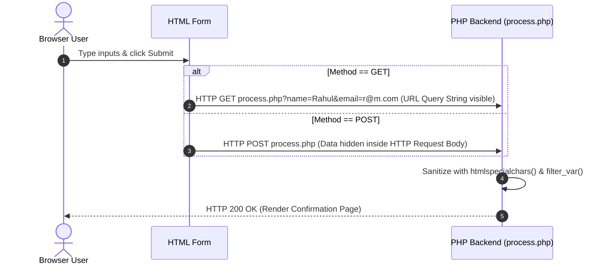

# Class 28: HTML Form Handling in PHP: `$_GET` & `$_POST` Superglobals & Data Sanitization

**Course:** Web Technology & Cloud Computing Applications – I  
**Unit:** Unit V - Server-Side Scripting & PHP Essentials: Basics, Forms & Databases  
**Target Duration:** 2 Hours (120 Minutes Continuous Session)  
**Self-Study Guide:** Designed for complete self-study. Every technical term is explained with simple real-world analogies without omitting any technical depth.

---

## 1. Class Session Objectives
By reading and studying this lecture guide line-by-line, you will be able to:
1. Explain how web browsers submit form data to backend PHP scripts.
2. Differentiate between `$_GET` (URL query string) and `$_POST` (HTTP request payload body) superglobals.
3. Sanitize user form inputs using `htmlspecialchars()`, `trim()`, and `filter_var()`.
4. Prevent Cross-Site Scripting (XSS) attacks in PHP web applications.

---

## 2. Recommended 2-Hour Time Allocation

| Time Range | Duration | Activity / Teaching Strategy |
|---|---|---|
| **00:00 - 00:20** | 20 Mins | **Recap & Hook:** Review HTML forms (`<form action="..." method="...">`). Demonstrate GET URL parameters vs hidden POST submission. |
| **00:20 - 00:50** | 30 Mins | **Deep Dive Theory:** `$_GET` vs `$_POST`, Superglobals, Security risks (XSS), `htmlspecialchars()`, Form validation routines. |
| **00:50 - 01:20** | 30 Mins | **Visual Diagram Breakdown:** GET vs POST Transmission Sequence Diagram & XSS Sanitization Pipeline. |
| **01:20 - 01:45** | 25 Mins | **Live Code Walkthrough:** Building an HTML registration form and a secure backend `process.php` form handler script. |
| **01:45 - 02:00** | 15 Mins | **Spot Quiz & Session Wrap-Up:** Student quiz questions, Next Class Teaser. |

---

## 3. Visual Flowcharts & Architectural Diagrams

### A. GET vs POST Form Data Transmission Flow


---

## 4. Key Jargon & Beginner Vocabulary Dictionary

> [!NOTE]
> * **Superglobal Variable:** A built-in PHP array variable that is automatically accessible from any script scope without requiring global declaration (e.g., `$_GET`, `$_POST`, `$_SERVER`).
> * **HTTP GET Method:** Form submission method appending data parameters directly onto the end of the URL query string (`page.php?key=val`), visible in browser history.
> * **HTTP POST Method:** Form submission method sending data enclosed inside the HTTP request message body, hidden from the browser address bar.
> * **Cross-Site Scripting (XSS):** A cyber security vulnerability where an attacker injects malicious JavaScript into form fields, which gets executed in other users' browsers if not sanitized.
> * **`htmlspecialchars()`:** A critical PHP sanitization function that converts dangerous HTML characters (like `<` and `>`) into safe HTML entities (`&lt;` and `&gt;`), disarming script injection.
> * **`trim()`:** A PHP string function that removes unwanted leading and trailing whitespace from user input.

---

## 5. In-Depth Topic Breakdown

### 5.1 Real-World Form Handling Analogies

1. **GET vs POST (Postcard vs Sealed Security Envelope):**
   * **HTTP GET (Writing your message on a clear glass postcard):** Anyone handling the postcard along the postal route can read the message printed right on the back (**URL address bar**). Fine for search terms (`?q=laptops`), but TERRIBLE for passwords!
   * **HTTP POST (Sealing your document in a heavy manila envelope):** The contents are hidden inside the envelope payload (**HTTP Body**). Passersby cannot see your password written inside.
2. **`htmlspecialchars()` (Disarming a Toy Gun):**
   * An attacker types `<script>alert('Hacked!')</script>` into a form field.
   * Without sanitization, the browser executes the script!
   * `htmlspecialchars()` strips the live firing pin, turning `<script>` into non-executable plain display text `&lt;script&gt;`!

---

### 5.2 GET vs POST Comparison Matrix

| Feature | HTTP GET (`$_GET`) | HTTP POST (`$_POST`) |
|---|---|---|
| **Data Location** | Appended to URL Address Bar query string | Encapsulated inside HTTP Request Body |
| **Visibility** | Visible to anyone looking at URL bar | Hidden from address bar |
| **Data Size Limit** | Limited (~2048 characters) | Unrestricted (configurable via `php.ini`) |
| **Bookmarkable?** | Yes | No |
| **Best Use Case** | Search forms, filters, pagination links | Password logins, registration, file uploads |

---

## 6. Practical Code Examples

### A. Secure Form Processor Script (`process.php`)

```php
<?php
// process.php - Secure PHP Form Handler

// Initialize error array and variables
$errors = array();
$name = $email = $course = "";

// Check if form was submitted via POST
if ($_SERVER["REQUEST_METHOD"] === "POST") {

    // 1. Extract and Trim Whitespace
    $name = trim($_POST['student_name'] ?? '');
    $email = trim($_POST['student_email'] ?? '');
    $course = trim($_POST['course_choice'] ?? '');

    // 2. Validate Name
    if (empty($name)) {
        $errors[] = "Full Name is required.";
    } else {
        // Sanitize for safe XSS display
        $name = htmlspecialchars($name);
    }

    // 3. Validate Email Format using filter_var
    if (empty($email)) {
        $errors[] = "Email Address is required.";
    } else if (!filter_var($email, FILTER_VALIDATE_EMAIL)) {
        $errors[] = "Invalid Email Address format.";
    } else {
        $email = htmlspecialchars($email);
    }

    // 4. Output Results or Errors
    echo "<h2>Form Submission Status</h2>";

    if (!empty($errors)) {
        echo "<div style='color:red;'><ul>";
        foreach ($errors as $error) {
            echo "<li>" . $error . "</li>";
        }
        echo "</ul></div>";
    } else {
        echo "<div style='color:green; padding:15px; border:1px solid green;'>";
        echo "<p><strong>Registration Successful!</strong></p>";
        echo "<p>Student Name: " . $name . "</p>";
        echo "<p>Email Address: " . $email . "</p>";
        echo "<p>Selected Course: " . htmlspecialchars($course) . "</p>";
        echo "</div>";
    }
} else {
    echo "<p style='color:red;'>Invalid Direct Access Request. Please submit the form.</p>";
}
?>
```

#### Line-by-Line Code Breakdown:
1. `if ($_SERVER["REQUEST_METHOD"] === "POST")`: Ensures script executes only when receiving a POST form submission.
2. `$name = trim($_POST['student_name'] ?? '')`: Fetches user input from `$_POST` superglobal while stripping leading/trailing whitespace.
3. `filter_var($email, FILTER_VALIDATE_EMAIL)`: Uses PHP's built-in email filter validator.
4. `htmlspecialchars($name)`: Converts `<` and `>` into HTML entities, preventing XSS injection attacks.

---

## 7. Interactive Discussion & Spot Quiz

### Discussion Questions
1. Why should sensitive data like passwords or credit card numbers NEVER be transmitted using HTTP GET forms?
2. How does `htmlspecialchars()` protect a PHP web application against Cross-Site Scripting (XSS) vulnerabilities?

### Spot Quiz
1. Which PHP superglobal array contains parameters submitted via `<form method="POST">`?
   - A) `$_GET`
   - B) `$_REQUEST`
   - C) `$_POST`
   - D) `$_SERVER`
2. Which PHP function is used to validate email format correctness?
   - A) `validate_email()`
   - B) `filter_var($email, FILTER_VALIDATE_EMAIL)`
   - C) `check_email()`
   - D) `sanitize_email()`

---

## 8. Class Summary & Next Session Teaser

* **Summary:** Today we covered PHP superglobals (`$_GET`, `$_POST`), GET vs POST form submission methods, XSS attack prevention, and sanitizing user inputs via `htmlspecialchars()` and `filter_var()`.
* **Next Class Teaser (Class 29):** Next class we explore **Seamless Integration of HTML & PHP Scripts, Self-Processing Forms & Sticky Inputs**!
