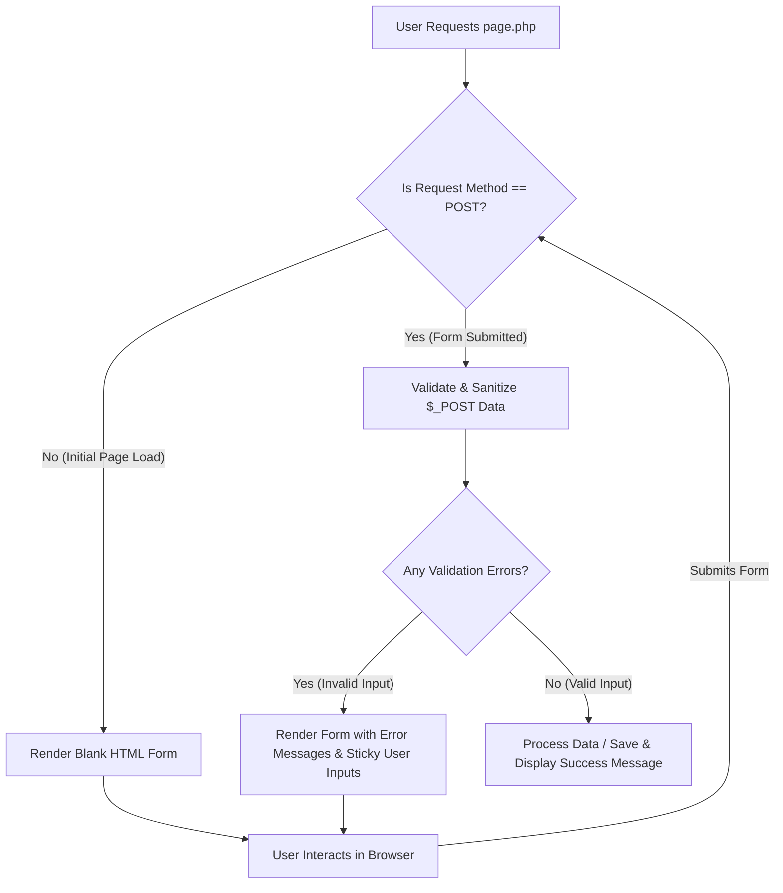

# Class 29: Seamless Integration of HTML & PHP Scripts and Self-Processing Forms

**Course:** Web Technology & Cloud Computing Applications – I  
**Unit:** Unit V - Server-Side Scripting & PHP Essentials: Basics, Forms & Databases  
**Target Duration:** 2 Hours (120 Minutes Continuous Session)  
**Self-Study Guide:** Designed for complete self-study. Every technical term is explained with simple real-world analogies without omitting any technical depth.

---

## 1. Class Session Objectives
By reading and studying this lecture guide line-by-line, you will be able to:
1. Seamlessly embed PHP logic within HTML structures using shorthand echo tags (`<?= $var ?>`) and alternative control syntax (`endif`, `endforeach`).
2. Construct Self-Processing Forms (single file containing both HTML form and PHP validation logic).
3. Utilize `$_SERVER["PHP_SELF"]` safely for action self-referencing with XSS protection.
4. Retain user form field values (sticky form inputs) after validation error re-renders.

---

## 2. Recommended 2-Hour Time Allocation

| Time Range | Duration | Activity / Teaching Strategy |
|---|---|---|
| **00:00 - 00:20** | 20 Mins | **Recap & Hook:** Review form POST handling. Discuss "How do we handle form validation and re-render user inputs without redirecting to a separate page?" |
| **00:20 - 00:50** | 30 Mins | **Deep Dive Theory:** Self-processing forms architecture, `PHP_SELF` XSS risk & mitigation, Alternative control syntax (`if:` ... `endif;`), Sticky forms. |
| **00:50 - 01:20** | 30 Mins | **Visual Diagram Breakdown:** Self-Processing Form Lifecycle & Re-render Loop Diagram. |
| **01:20 - 01:45** | 25 Mins | **Live Code Walkthrough:** Building a complete single-file self-processing registration script with error messages and sticky inputs. |
| **01:45 - 02:00** | 15 Mins | **Spot Quiz & Session Wrap-Up:** Student quiz questions, Next Class Teaser. |

---

## 3. Visual Flowcharts & Architectural Diagrams

### A. Self-Processing Single-File Form Lifecycle


---

## 4. Key Jargon & Beginner Vocabulary Dictionary

> [!NOTE]
> * **Self-Processing Form:** A single `.php` file containing both the visual HTML `<form>` layout and the server-side PHP validation/processing logic.
> * **Sticky Form:** A form design pattern that retains and re-populates previously entered user values inside input fields if validation errors occur.
> * **Shorthand Echo Tag (`<?= $var ?>`):** A concise PHP syntax shortcut equivalent to `<?php echo $var; ?>`.
> * **Alternative Control Syntax:** A clean template syntax replacing curly braces with colons and explicit end tags (e.g., `if (...): ... endif;`), improving readability in HTML files.
> * **`$_SERVER["PHP_SELF"]`:** A superglobal variable containing the path of the currently executing script, used to submit forms back to the same file.

---

## 5. In-Depth Topic Breakdown

### 5.1 Real-World Self-Processing & Sticky Form Analogies

1. **Self-Processing Form (The Self-Serve ATM Screen):**
   * Imagine interacting with a bank ATM screen (`page.php`). 
   * When you first approach, the screen displays a blank input asking for your PIN (**Initial GET Request**). 
   * You type your PIN and press Enter (**POST Submission**). The ATM validates your PIN. If you typed an incorrect PIN, the exact same machine screen re-renders displaying: *"Incorrect PIN, please try again!"* without forcing you to walk over to a different machine!
2. **Sticky Form (The Helpful Application Desk Clerk):**
   * Imagine submitting a paper university application. The clerk notices you forgot to sign Section 3. Instead of throwing your paper away and forcing you to fill out a blank form from scratch, she hands your paper back with your typed name and address intact (**Sticky Inputs**), pointing only to the missing signature line!

---

### 5.2 Shorthand Output & Alternative Control Syntax

#### 1. Standard Echo vs Shorthand Echo Tag
* Standard: `<?php echo $title; ?>`
* Shorthand: `<?= $title ?>`

#### 2. Alternative Syntax for HTML Templates
Cleaner template syntax avoiding cluttered curly braces:
```php
<?php if ($isLoggedIn): ?>
    <h2>Welcome Back, <?= $username ?>!</h2>
<?php else: ?>
    <h2>Please Log In</h2>
<?php endif; ?>
```

---

### 5.3 Sticky Forms Concept

A "Sticky Form" remembers and re-populates user-entered values in input fields if form validation fails, preventing the user from having to re-type everything:
`<input type="text" name="email" value="<?= htmlspecialchars($email) ?>">`

---

## 6. Practical Code Examples

### A. Complete Self-Processing Sticky Form Script (`contact.php`)

```php
<?php
// contact.php - Single-File Self-Processing Form

// Initialize error array and sticky variable placeholders
$errors = array();
$name = "";
$email = "";
$message = "";
$successMsg = "";

// Check if form has been submitted via POST
if ($_SERVER["REQUEST_METHOD"] === "POST") {

    // Extract & sanitize user inputs
    $name = trim($_POST['name'] ?? '');
    $email = trim($_POST['email'] ?? '');
    $message = trim($_POST['message'] ?? '');

    // Validation Rules
    if (empty($name)) {
        $errors['name'] = "Name is required.";
    }

    if (empty($email)) {
        $errors['email'] = "Email is required.";
    } else if (!filter_var($email, FILTER_VALIDATE_EMAIL)) {
        $errors['email'] = "Invalid email format.";
    }

    if (empty($message)) {
        $errors['message'] = "Message cannot be empty.";
    }

    // If no validation errors, process submission
    if (empty($errors)) {
        $successMsg = "Thank you, " . htmlspecialchars($name) . "! Your message has been sent.";
        // Reset sticky values on successful submission
        $name = $email = $message = "";
    }
}
?>

<!DOCTYPE html>
<html lang="en">
<head>
    <meta charset="UTF-8">
    <title>Contact Us - Self-Processing Form</title>
    <style>
        body { font-family: Arial, sans-serif; padding: 20px; background-color: #f8f9fa; }
        .form-card { max-width: 500px; margin: 0 auto; background: white; padding: 25px; border-radius: 8px; box-shadow: 0 2px 5px rgba(0,0,0,0.1); }
        .error { color: #dc3545; font-size: 0.85rem; margin-top: 4px; }
        .success-box { background: #d4edda; color: #155724; padding: 12px; border-radius: 4px; margin-bottom: 15px; }
        .input-field { width: 100%; padding: 8px; box-sizing: border-box; margin-top: 5px; }
    </style>
</head>
<body>

    <div class="form-card">
        <h2>Contact Department</h2>

        <!-- Display Success Message -->
        <?php if (!empty($successMsg)): ?>
            <div class="success-box"><?= $successMsg ?></div>
        <?php endif; ?>

        <!-- Self-Processing Form with XSS-Safe PHP_SELF -->
        <form action="<?= htmlspecialchars($_SERVER["PHP_SELF"]); ?>" method="POST">
            <p>
                <label for="name">Your Name:</label>
                <input type="text" id="name" name="name" class="input-field" value="<?= htmlspecialchars($name) ?>">
                <?php if (isset($errors['name'])): ?>
                    <div class="error"><?= $errors['name'] ?></div>
                <?php endif; ?>
            </p>

            <p>
                <label for="email">Email Address:</label>
                <input type="text" id="email" name="email" class="input-field" value="<?= htmlspecialchars($email) ?>">
                <?php if (isset($errors['email'])): ?>
                    <div class="error"><?= $errors['email'] ?></div>
                <?php endif; ?>
            </p>

            <p>
                <label for="message">Message:</label>
                <textarea id="message" name="message" rows="4" class="input-field"><?= htmlspecialchars($message) ?></textarea>
                <?php if (isset($errors['message'])): ?>
                    <div class="error"><?= $errors['message'] ?></div>
                <?php endif; ?>
            </p>

            <p>
                <button type="submit" style="padding: 10px 20px; background: #003366; color: white; border: none; border-radius: 4px; cursor: pointer;">Send Message</button>
            </p>
        </form>
    </div>

</body>
</html>
```

---

## 7. Interactive Discussion & Spot Quiz

### Discussion Questions
1. What is a "Self-Processing Form" in PHP, and why is wrapping `htmlspecialchars($_SERVER["PHP_SELF"])` in the `action` attribute necessary for security?
2. What does the term "Sticky Form" mean in user interface design, and how is it implemented using PHP string escaping in `value="..."` attributes?

### Spot Quiz
1. Which PHP shorthand tag is equivalent to `<?php echo $variable; ?>`?
   - A) `<? $variable ?>`
   - B) `<?= $variable ?>`
   - C) `<?# $variable ?>`
   - D) `<% $variable %>`
2. Which superglobal variable holds the filename of the currently executing PHP script?
   - A) `$_SERVER['SCRIPT_URL']`
   - B) `$_SERVER['PHP_SELF']`
   - C) `$_SERVER['HTTP_HOST']`
   - D) `$_ENV['FILE_NAME']`

---

## 8. Class Summary & Next Session Teaser

* **Summary:** Today we covered PHP-HTML template integration, shorthand echo tags (`<?= ?>`), alternative control syntax (`endif`), self-processing forms, and sticky input fields.
* **Next Class Teaser (Class 30):** Next class completes our curriculum with **User Form Database Connectivity: Connecting PHP to MySQL, Executing SQL Queries & Building Database-Driven Web Applications**!
