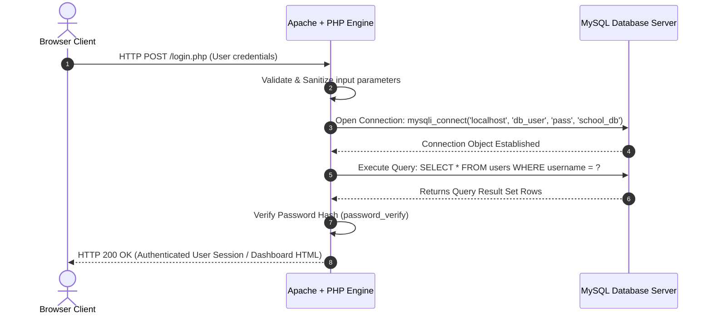

# Class 30: User Form Database Connectivity: PHP & MySQL Integration

**Course:** Web Technology & Cloud Computing Applications – I  
**Unit:** Unit V - Server-Side Scripting & PHP Essentials: Basics, Forms & Databases  
**Target Duration:** 2 Hours (120 Minutes Continuous Session)  
**Self-Study Guide:** Designed for complete self-study. Every technical term is explained with simple real-world analogies without omitting any technical depth.

---

## 1. Class Session Objectives
By reading and studying this lecture guide line-by-line, you will be able to:
1. Explain relational database connectivity architectures connecting web servers to MySQL database engines.
2. Establish database connections using PHP `mysqli` extension (Procedural & Object-Oriented) and PDO.
3. Execute SQL Data Manipulation Language (DML) queries (`INSERT`, `SELECT`, `UPDATE`, `DELETE`) from PHP.
4. Construct a database-driven web application with user login authentication and dynamic table rendering.

---

## 2. Recommended 2-Hour Time Allocation

| Time Range | Duration | Activity / Teaching Strategy |
|---|---|---|
| **00:00 - 00:20** | 20 Mins | **Recap & Course Capstone Hook:** Review self-processing forms. Connect frontend HTML forms to backend MySQL database. |
| **00:20 - 00:50** | 30 Mins | **Deep Dive Theory:** Database connection workflow, `mysqli_connect()`, SQL query execution, Prepared statements for SQL Injection prevention. |
| **00:50 - 01:20** | 30 Mins | **Visual Diagram Breakdown:** 3-Tier Web Application Architecture Diagram (Browser $\rightarrow$ PHP Web Server $\rightarrow$ MySQL DB). |
| **01:20 - 01:45** | 25 Mins | **Live Code Walkthrough:** Building a complete DB Connection helper, User Registration script, and SQL Record Fetcher. |
| **01:45 - 02:00** | 15 Mins | **Spot Quiz & Semester Course Wrap-Up:** Student quiz questions, Course Completion Summary. |

---

## 3. Visual Flowcharts & Architectural Diagrams

### A. 3-Tier Web Application Database Architecture


---

## 4. Key Jargon & Beginner Vocabulary Dictionary

> [!NOTE]
> * **Relational Database (RDBMS):** A structured database system (like MySQL) that stores data inside organized tables consisting of rows (records) and columns (fields).
> * **MySQL:** An open-source relational database management system widely paired with PHP for web application storage.
> * **MySQLi Extension:** A PHP database driver extension (`i` = Improved) providing procedural and object-oriented functions to interact with MySQL databases.
> * **PDO (PHP Data Objects):** A lightweight database abstraction layer in PHP supporting 12 different database engines (MySQL, PostgreSQL, SQLite, Oracle).
> * **Prepared Statements:** A secure database execution technique where SQL query structures are compiled separately from user input parameters, neutralizing SQL Injection attacks.
> * **SQL Injection:** A dangerous cyber attack where malicious SQL code is typed into form fields to manipulate or destroy database tables.
> * **`mysqli_connect()`:** The PHP function used to establish an active network connection to a MySQL database server.
> * **`mysqli_fetch_assoc()`:** A PHP function that extracts the next result row from a SQL query result set as an associative array.

---

## 5. In-Depth Topic Breakdown

### 5.1 Real-World 3-Tier Database & Prepared Statement Analogies

1. **3-Tier Web Application Architecture (The Restaurant Analogy):**
   * **Tier 1 (Browser Client):** Customer sitting at a dining table looking at a printed menu.
   * **Tier 2 (PHP Web Server):** The waiter taking your order, checking your age ID card, and walking back into the kitchen.
   * **Tier 3 (MySQL Database):** The large walk-in refrigerator pantry in the back storing ingredients in labeled shelves and rows. The waiter asks the pantry manager for ingredients (`SELECT * FROM users`), and the pantry manager hands back a tray of food items (Query Result Set)!
2. **Prepared Statements (The Bulletproof Bank Counter):**
   * Imagine a bank teller window protected by bulletproof glass and pre-printed deposit slots. 
   * Without prepared statements, a customer hands the teller a handwritten paper saying: *"Transfer $100 OR Give Me All Money in Vault!"* (SQL Injection). The naive teller reads the whole note as a command and hands over the vault!
   * With **Prepared Statements**, the query template (`SELECT * FROM users WHERE username = ?`) is pre-compiled behind bulletproof glass. User input is strictly treated as plain text data inserted into the parameter slot `?`, preventing any injected SQL commands from altering the query!

---

### 5.2 PHP MySQL Database Extension Options

| Extension | Interface Style | Database Support | Prepared Statements Support | Recommendation |
|---|---|---|---|---|
| **MySQLi (i = Improved)** | Procedural & Object-Oriented | MySQL Only | Yes (`mysqli_stmt`) | Excellent for MySQL projects |
| **PDO (PHP Data Objects)** | Object-Oriented Only | 12 Different Database Engines (MySQL, PostgreSQL, SQLite, Oracle) | Yes (`PDOStatement`) | Recommended for enterprise multi-database portability |

---

### 5.3 Core Database Operations Workflow

1. **Connect:** `$conn = mysqli_connect($host, $user, $pass, $dbname);`
2. **Check Connection:** `if (!$conn) { die("Connection failed: " . mysqli_connect_error()); }`
3. **Execute SQL Query:** `$result = mysqli_query($conn, $sql);`
4. **Fetch Results:** `while ($row = mysqli_fetch_assoc($result)) { ... }`
5. **Close Connection:** `mysqli_close($conn);`

---

## 6. Practical Code Examples

### A. Database Connection & User Login Authentication Script

#### 1. Database Connection Configuration (`db_config.php`)
```php
<?php
// db_config.php - Centralized Database Connection Script

$db_host = "localhost";
$db_user = "root";
$db_pass = "";
$db_name = "university_db";

// Create MySQLi Connection
$conn = mysqli_connect($db_host, $db_user, $db_pass, $db_name);

// Check Connection Status
if (!$conn) {
    die("Database Connection Error: " . mysqli_connect_error());
}
?>
```

#### 2. User Login Form & Database Verification (`login.php`)
```php
<?php
// login.php - Database Driven User Authentication Script
require_once "db_config.php";

$message = "";

if ($_SERVER["REQUEST_METHOD"] === "POST") {
    $username = trim($_POST['username'] ?? '');
    $password = trim($_POST['password'] ?? '');

    if (!empty($username) && !empty($password)) {
        
        // Prepared Statement to prevent SQL Injection
        $sql = "SELECT id, username, password_hash, stream FROM users WHERE username = ?";
        
        if ($stmt = mysqli_prepare($conn, $sql)) {
            mysqli_stmt_bind_param($stmt, "s", $username);
            mysqli_stmt_execute($stmt);
            $result = mysqli_stmt_get_result($stmt);

            if ($row = mysqli_fetch_assoc($result)) {
                // Verify password against stored hash (simulated direct match for basic demo)
                if ($password === $row['password_hash']) {
                    $message = "<p style='color:green;'>Login Successful! Welcome, " . htmlspecialchars($row['username']) . " (" . $row['stream'] . ")</p>";
                } else {
                    $message = "<p style='color:red;'>Invalid password credentials.</p>";
                }
            } else {
                $message = "<p style='color:red;'>No account found with that username.</p>";
            }
            mysqli_stmt_close($stmt);
        }
    } else {
        $message = "<p style='color:red;'>Please enter both username and password.</p>";
    }
}
?>

<!DOCTYPE html>
<html lang="en">
<head>
    <meta charset="UTF-8">
    <title>Database User Login - Mandsaur University</title>
    <style>
        body { font-family: Arial; background-color: #f4f6f9; padding: 40px; }
        .login-card { max-width: 400px; margin: 0 auto; background: white; padding: 30px; border-radius: 8px; box-shadow: 0 4px 10px rgba(0,0,0,0.1); }
        .input-group { margin-bottom: 15px; }
        .input-group label { display: block; margin-bottom: 5px; }
        .input-group input { width: 100%; padding: 8px; box-sizing: border-box; }
    </style>
</head>
<body>

    <div class="login-card">
        <h2>Student Portal Login</h2>
        <?= $message ?>
        
        <form action="login.php" method="POST">
            <div class="input-group">
                <label for="username">Username:</label>
                <input type="text" id="username" name="username" required>
            </div>
            <div class="input-group">
                <label for="password">Password:</label>
                <input type="password" id="password" name="password" required>
            </div>
            <button type="submit" style="width:100%; padding:10px; background:#003366; color:white; border:none; border-radius:4px; cursor:pointer;">Log In</button>
        </form>
    </div>

</body>
</html>
```

---

## 7. Interactive Discussion & Spot Quiz

### Discussion Questions
1. What is SQL Injection, and how do Prepared Statements (`mysqli_prepare()` / `bind_param()`) prevent attackers from manipulating backend database queries?
2. What is the difference between `mysqli_fetch_assoc()` and `mysqli_fetch_array()` when processing SQL result sets in PHP?

### Spot Quiz
1. Which PHP function is used to establish a connection to a MySQL database using the procedural MySQLi extension?
   - A) `mysql_open()`
   - B) `mysqli_connect()`
   - C) `db_connect()`
   - D) `PDO_connect()`
2. Which function extracts the next result row as an Associative Array from a MySQLi result set?
   - A) `mysqli_fetch_assoc()`
   - B) `mysqli_get_rows()`
   - C) `mysqli_read_array()`
   - D) `mysqli_fetch_object()`

---

## 8. Class Summary & Course Conclusion

* **Class Summary:** Today we completed the final lecture of our curriculum by mastering PHP and MySQL database connectivity, executing SQL queries, preventing SQL injection via prepared statements, and building database-driven login applications.
* **Course Conclusion:** Congratulations! You have completed all 30 continuous theory sessions of the **Web Technology & Cloud Computing Applications – I** curriculum!
