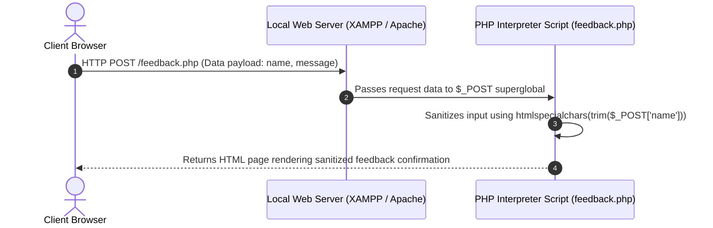

# Lab 14: PHP Server-Side Fundamentals & Form Data Processing (GET & POST)

**Course:** Web Technology Lab & Cloud Computing Applications – I Lab  
**Course Code:** 25SACS070P / 25BCC100P  
**Covered Merged Exp:** Merged Exp 12 `[Covers: 25SACS070P Exp 29, 30 | 25BCC100P Exp 26, 27]`  
**Target Duration:** 2 Hours (120 Minutes Continuous Lab)  
**Scaffolding Method:** Skeleton Project Template  

---

## 1. Lab Session Objectives & Target Output
By the end of this 2-hour lab session, students will be able to:
1. Write server-side PHP scripts embedded within HTML documents using `<?php ... ?>` tags.
2. Construct HTML submission forms that transmit user input to PHP backend scripts.
3. Access submitted data using superglobal arrays (`$_GET` and `$_POST`) `[Covers: SACS Exp 30 | BCC Exp 27]`.
4. Implement input sanitization (`htmlspecialchars()`, `trim()`) to prevent Cross-Site Scripting (XSS) attacks.

---

## 2. 120-Minute Lab Time Breakdown

| Time Range | Duration | Activity & Teaching Strategy |
|---|---|---|
| **00:00 - 00:15** | 15 Mins | **Visual Target & Server Setup Briefing:** Demonstrate running Apache/XAMPP server and inspecting GET URL parameters vs POST hidden body payloads. |
| **00:15 - 00:45** | 30 Mins | **Guided Live-Coding Part I (GET Form):** Build `search.php` receiving query string parameters via `$_GET['q']`. |
| **00:45 - 01:15** | 30 Mins | **Guided Live-Coding Part II (POST Form):** Build `feedback.php` receiving form submissions via `$_POST` and sanitizing via `htmlspecialchars()`. |
| **01:15 - 01:45** | 30 Mins | **Independent Student Challenge ("You Do"):** Build a Calculator Form in PHP that takes two numbers and an operator (+, -, *) via POST. |
| **01:45 - 02:00** | 15 Mins | **Troubleshooting & Viva Sign-off:** Fix `Undefined index` PHP warning notices using `isset()`, conduct viva Q&A, sign lab record. |

---

## 3. UI Wireframe & Server Processing Pipeline



---

## 4. Code Scaffolding / Project Skeleton

> [!NOTE]
> Ensure XAMPP or local PHP environment is active (`http://localhost/lab14/`).

---

## 5. Step-by-Step Guided Implementation Code Walkthrough

#### File 1: GET Search Query Form & Script (`search.php`)
```php
<?php
// search.php - Demonstrating $_GET Processing
$searchQuery = $_GET['q'] ?? '';
$cleanQuery = htmlspecialchars(trim($searchQuery), ENT_QUOTES, 'UTF-8');
?>
<!DOCTYPE html>
<html lang="en">
<head>
    <meta charset="UTF-8">
    <title>PHP GET Search Demo</title>
</head>
<body style="font-family: Arial; padding: 30px;">

    <h2>Course Search (HTTP GET Method)</h2>
    
    <!-- GET Form appends inputs to URL address bar -->
    <form action="search.php" method="GET">
        <input type="text" name="q" placeholder="Search course keyword..." value="<?= $cleanQuery ?>">
        <button type="submit">Search</button>
    </form>

    <?php if (!empty($cleanQuery)): ?>
        <div style="margin-top: 20px; padding: 15px; background: #e3f2fd;">
            <p>Search Results for: <strong><?= $cleanQuery ?></strong></p>
            <p><em>URL Address Bar: search.php?q=<?= urlencode($cleanQuery) ?></em></p>
        </div>
    <?php endif; ?>

</body>
</html>
```

#### File 2: POST Form Submission & Sanitization Backend (`feedback.php`)
```php
<?php
// feedback.php - Demonstrating $_POST Processing & Sanitization
$name = "";
$message = "";
$status = "";

if ($_SERVER["REQUEST_METHOD"] === "POST") {
    // 1. Extract raw inputs
    $rawName = $_POST['student_name'] ?? '';
    $rawMessage = $_POST['student_msg'] ?? '';

    // 2. Sanitize inputs for XSS security
    $name = htmlspecialchars(trim($rawName), ENT_QUOTES, 'UTF-8');
    $message = htmlspecialchars(trim($rawMessage), ENT_QUOTES, 'UTF-8');

    if (!empty($name) && !empty($message)) {
        $status = "success";
    } else {
        $status = "error";
    }
}
?>
<!DOCTYPE html>
<html lang="en">
<head>
    <meta charset="UTF-8">
    <title>Student Feedback (HTTP POST)</title>
    <style>
        body { font-family: Arial; padding: 30px; background-color: #f4f6f9; }
        .card { max-width: 500px; margin: 0 auto; background: white; padding: 25px; border-radius: 8px; box-shadow: 0 4px 8px rgba(0,0,0,0.1); }
        .success { background: #d4edda; color: #155724; padding: 12px; border-radius: 4px; }
        .error { background: #f8d7da; color: #721c24; padding: 12px; border-radius: 4px; }
    </style>
</head>
<body>

    <div class="card">
        <h2>Submit Student Feedback (POST)</h2>

        <?php if ($status === "success"): ?>
            <div class="success">
                <h4>Feedback Submitted Successfully!</h4>
                <p><strong>Student:</strong> <?= $name ?></p>
                <p><strong>Message:</strong> <?= $message ?></p>
            </div>
        <?php elseif ($status === "error"): ?>
            <div class="error">Please fill in all mandatory fields.</div>
        <?php endif; ?>

        <form action="feedback.php" method="POST" style="margin-top: 15px;">
            <p>
                <label>Student Name:</label><br>
                <input type="text" name="student_name" style="width: 100%; padding: 8px;" required>
            </p>
            <p>
                <label>Feedback Message:</label><br>
                <textarea name="student_msg" rows="4" style="width: 100%; padding: 8px;" required></textarea>
            </p>
            <button type="submit" style="padding: 10px 20px; background: #003366; color: white; border: none; cursor: pointer;">Submit Feedback</button>
        </form>
    </div>

</body>
</html>
```

---

## 6. Student Extension Challenge Task ("You Do")

**Task Requirements (Time: 30 Mins):**
1. Create a PHP Calculator form taking `$num1`, `$num2`, and `$operator` (`+`, `-`, `*`, `/`) via POST.
2. Output the computed arithmetic result inside a styled result box.

---

## 7. Common Bugs & Troubleshooting Guide

* **Bug 1: `Warning: Undefined array key "student_name"`.**
  * *Cause:* Script tries to access `$_POST['student_name']` on initial page load before form submission.
  * *Fix:* Use null coalescing operator `$_POST['student_name'] ?? ''` or check `if (isset($_POST['student_name']))`.

---

## 8. Viva Voce Oral Questions & Answers

1. **Q: Why should user passwords be transmitted via POST rather than GET?**  
   *A:* GET appends form parameters directly to the URL string visible in history and server logs; POST encapsulates parameters securely inside the HTTP request body.
2. **Q: What is the purpose of `htmlspecialchars()` in PHP form processing?**  
   *A:* It escapes special characters like `<` and `>` into HTML entities, preventing malicious XSS script execution.
