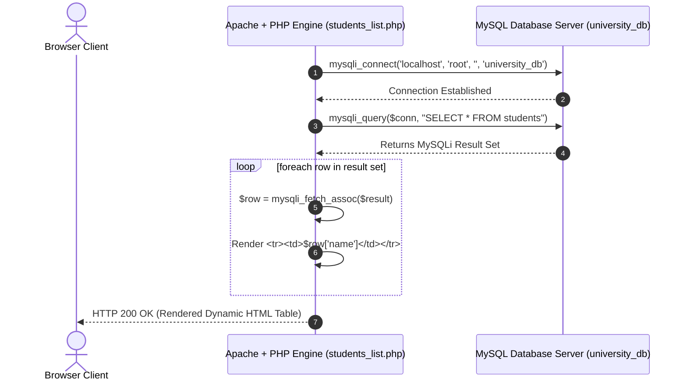

# Lab 15: PHP & MySQL Database Connectivity & Dynamic Web Pages

**Course:** Web Technology Lab & Cloud Computing Applications – I Lab  
**Course Code:** 25SACS070P / 25BCC100P  
**Covered Merged Exp:** Merged Exp 13 (Session 1 of 2) `[Covers: 25SACS070P Exp 28 | 25BCC100P Exp 25]`  
**Target Duration:** 2 Hours (120 Minutes Continuous Lab)  
**Scaffolding Method:** Skeleton Project Template  

---

## 1. Lab Session Objectives & Target Output
By the end of this 2-hour lab session, students will be able to:
1. Connect PHP scripts to a local MySQL database engine using `mysqli_connect()`.
2. Handle connection errors gracefully using `mysqli_connect_error()`.
3. Execute SQL `SELECT` queries to retrieve database records.
4. Render database rows dynamically into HTML tables using `mysqli_fetch_assoc()` `[Covers: SACS Exp 28 | BCC Exp 25]`.

---

## 2. 120-Minute Lab Time Breakdown

| Time Range | Duration | Activity & Teaching Strategy |
|---|---|---|
| **00:00 - 00:15** | 15 Mins | **Visual Target & DB Setup Briefing:** Create `university_db` database and `students` table in phpMyAdmin. Show dynamic DB table rendering. |
| **00:15 - 00:45** | 30 Mins | **Guided Live-Coding Part I (DB Connection Helper):** Build `db_connect.php` establishing `mysqli_connect()` to MySQL. |
| **00:45 - 01:15** | 30 Mins | **Guided Live-Coding Part II (Dynamic Query & Table Rendering):** Execute `SELECT * FROM students` and loop through results using `while($row = mysqli_fetch_assoc($result))`. |
| **01:15 - 01:45** | 30 Mins | **Independent Student Challenge ("You Do"):** Add a SQL filter displaying only students enrolled in the `"Cyber Security"` stream. |
| **01:45 - 02:00** | 15 Mins | **Troubleshooting & Viva Sign-off:** Fix MySQL access denied / unknown database errors, conduct viva Q&A, sign lab record. |

---

## 3. Database Schema & Data Flow Architecture



---

## 4. Code Scaffolding / Project Skeleton

> [!NOTE]
> Have students execute this SQL script in phpMyAdmin prior to lab coding:
> ```sql
> CREATE DATABASE university_db;
> USE university_db;
> CREATE TABLE students (
>     id INT AUTO_INCREMENT PRIMARY KEY,
>     name VARCHAR(100) NOT NULL,
>     stream VARCHAR(50) NOT NULL,
>     gpa DECIMAL(3,2) NOT NULL
> );
> INSERT INTO students (name, stream, gpa) VALUES
> ('Rahul Dhangar', 'Cyber Security', 3.85),
> ('Priya Sharma', 'Cloud Computing', 3.90),
> ('Amit Verma', 'Web Technology', 3.65);
> ```

---

## 5. Step-by-Step Guided Implementation Code Walkthrough

#### File 1: Database Connection Helper (`db_connect.php`)
```php
<?php
// db_connect.php - Centralized MySQL Database Connection Helper

$dbHost = "localhost";
$dbUser = "root";
$dbPass = "";
$dbName = "university_db";

// Establish MySQLi Connection
$conn = mysqli_connect($dbHost, $dbUser, $dbPass, $dbName);

// Check Connection Integrity
if (!$conn) {
    die("Database Connection Failure: " . mysqli_connect_error());
}
?>
```

#### File 2: Dynamic Database Table Renderer (`students_list.php`)
```php
<?php
// students_list.php - Dynamic Web Page rendering MySQL Data
require_once "db_connect.php";

// Execute SQL Query
$sql = "SELECT id, name, stream, gpa FROM students ORDER BY id ASC";
$result = mysqli_query($conn, $sql);
?>

<!DOCTYPE html>
<html lang="en">
<head>
    <meta charset="UTF-8">
    <title>Dynamic Student Records - Database Driven</title>
    <style>
        body { font-family: Arial; padding: 30px; background: #f4f6f9; }
        .container { max-width: 800px; margin: 0 auto; background: white; padding: 25px; border-radius: 8px; box-shadow: 0 4px 8px rgba(0,0,0,0.1); }
        table { width: 100%; border-collapse: collapse; margin-top: 20px; }
        th, td { border: 1px solid #ddd; padding: 12px; text-align: left; }
        th { background-color: #003366; color: white; }
        tr:nth-child(even) { background-color: #f9f9f9; }
    </style>
</head>
<body>

    <div class="container">
        <h2>Database-Driven Student Roster</h2>
        <p>This table is dynamically populated from the MySQL <code>university_db</code> database.</p>

        <table>
            <thead>
                <tr>
                    <th>Student ID</th>
                    <th>Full Name</th>
                    <th>Assigned Stream</th>
                    <th>GPA</th>
                </tr>
            </thead>
            <tbody>
                <?php if (mysqli_num_rows($result) > 0): ?>
                    <?php while ($row = mysqli_fetch_assoc($result)): ?>
                        <tr>
                            <td><?= $row['id'] ?></td>
                            <td><strong><?= htmlspecialchars($row['name']) ?></strong></td>
                            <td><?= htmlspecialchars($row['stream']) ?></td>
                            <td><?= $row['gpa'] ?></td>
                        </tr>
                    <?php endwhile; ?>
                <?php else: ?>
                    <tr>
                        <td colspan="4" align="center">No student records found in database.</td>
                    </tr>
                <?php endif; ?>
            </tbody>
        </table>
    </div>

</body>
</html>
<?php
// Close database connection
mysqli_close($conn);
?>
```

---

## 6. Student Extension Challenge Task ("You Do")

**Task Requirements (Time: 30 Mins):**
1. Add an HTML search form at the top of `students_list.php` allowing users to filter students by stream name.
2. Modify the SQL query dynamically: `SELECT * FROM students WHERE stream LIKE '%$search%'`.

---

## 7. Common Bugs & Troubleshooting Guide

* **Bug 1: `Fatal error: Uncaught Error: Call to a member function fetch_assoc() on bool`.**
  * *Cause:* The SQL query contains a syntax error, causing `mysqli_query()` to return `false` instead of a result object.
  * *Fix:* Print SQL error details using `echo mysqli_error($conn)` to diagnose query syntax.

---

## 8. Viva Voce Oral Questions & Answers

1. **Q: What does `mysqli_fetch_assoc()` do when called inside a `while` loop?**  
   *A:* It fetches the current result row as an Associative Array (indexed by column names) and advances the result pointer to the next row until returning `null`.
2. **Q: Why is storing connection credentials in a separate `db_connect.php` file best practice?**  
   *A:* It avoids duplicating database connection logic across multiple scripts and allows database credential updates in a single location.
