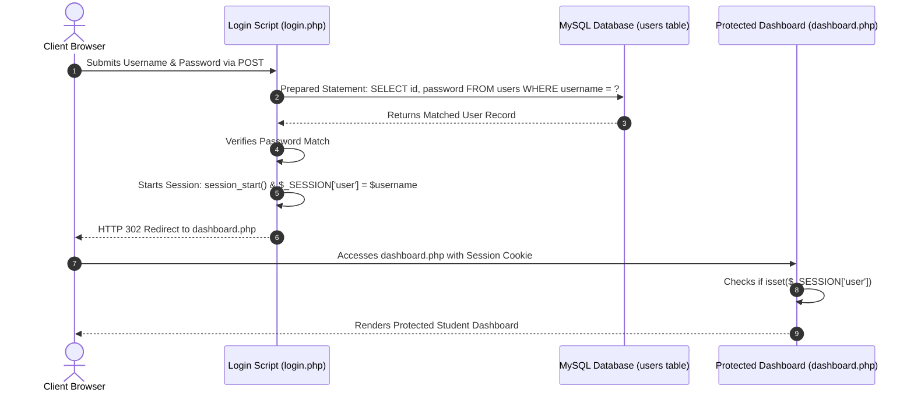

# Lab 16: Database-Driven User Registration & Login Authentication System

**Course:** Web Technology Lab & Cloud Computing Applications – I Lab  
**Course Code:** 25SACS070P / 25BCC100P  
**Covered Merged Exp:** Merged Exp 13 (Session 2 of 2) `[Covers: 25SACS070P Exp 27 | 25BCC100P Exp 24]`  
**Target Duration:** 2 Hours (120 Minutes Continuous Lab)  
**Scaffolding Method:** Skeleton Project Template  

---

## 1. Lab Session Objectives & Target Output
By the end of this 2-hour lab session, students will be able to:
1. Construct a Database-Driven User Registration and Login Authentication System.
2. Execute SQL `INSERT` statements to persist new user credentials securely.
3. Utilize Prepared Statements (`mysqli_prepare()`, `bind_param()`) to protect authentication forms against SQL Injection attacks.
4. Implement complete User Login Authentication & Session Management in PHP `[Covers: SACS Exp 27 | BCC Exp 24]`.

---

## 2. 120-Minute Lab Time Breakdown

| Time Range | Duration | Activity & Teaching Strategy |
|---|---|---|
| **00:00 - 00:15** | 15 Mins | **Visual Target & Auth Briefing:** Demonstrate registering a user account in `register.php`, logging in via `login.php`, and accessing a protected `dashboard.php`. |
| **00:15 - 00:45** | 30 Mins | **Guided Live-Coding Part I (User Registration):** Build `register.php` with prepared statements inserting new users into `users` table. |
| **00:45 - 01:15** | 30 Mins | **Guided Live-Coding Part II (User Login & Sessions):** Build `login.php` verifying credentials and setting `$_SESSION['user_id']`. |
| **01:15 - 01:45** | 30 Mins | **Independent Student Challenge ("You Do"):** Build a `logout.php` script that destroys the user session and redirects to `login.php`. |
| **01:45 - 02:00** | 15 Mins | **Troubleshooting & Lab Course Sign-off:** Troubleshoot session start bugs (`session_start()`), conduct final viva Q&A, sign lab record. |

---

## 3. User Authentication & Session Data Architecture



---

## 4. Code Scaffolding / Project Skeleton

> [!NOTE]
> Execute this SQL statement to create the `users` table in `university_db`:
> ```sql
> USE university_db;
> CREATE TABLE users (
>     id INT AUTO_INCREMENT PRIMARY KEY,
>     username VARCHAR(50) UNIQUE NOT NULL,
>     password VARCHAR(255) NOT NULL,
>     created_at TIMESTAMP DEFAULT CURRENT_TIMESTAMP
> );
> ```

---

## 5. Step-by-Step Guided Implementation Code Walkthrough

#### File 1: User Registration System (`register.php`)
```php
<?php
// register.php - User Registration Backend
require_once "db_connect.php";

$message = "";

if ($_SERVER["REQUEST_METHOD"] === "POST") {
    $user = trim($_POST['username'] ?? '');
    $pass = trim($_POST['password'] ?? '');

    if (!empty($user) && !empty($pass)) {
        // Hash password securely
        $hashedPass = password_hash($pass, PASSWORD_DEFAULT);

        // Prepared Statement inserting user record
        $sql = "INSERT INTO users (username, password) VALUES (?, ?)";
        
        if ($stmt = mysqli_prepare($conn, $sql)) {
            mysqli_stmt_bind_param($stmt, "ss", $user, $hashedPass);
            
            if (mysqli_stmt_execute($stmt)) {
                $message = "<p style='color:green;'>Registration successful! <a href='login.php'>Click here to Log In</a></p>";
            } else {
                $message = "<p style='color:red;'>Username already exists. Choose another.</p>";
            }
            mysqli_stmt_close($stmt);
        }
    } else {
        $message = "<p style='color:red;'>Please fill in all fields.</p>";
    }
}
?>

<!DOCTYPE html>
<html lang="en">
<head>
    <meta charset="UTF-8">
    <title>User Registration - Lab 16</title>
    <style>
        body { font-family: Arial; padding: 40px; background: #f4f6f9; }
        .card { max-width: 400px; margin: 0 auto; background: white; padding: 30px; border-radius: 8px; box-shadow: 0 4px 8px rgba(0,0,0,0.1); }
    </style>
</head>
<body>

    <div class="card">
        <h2>Student User Registration</h2>
        <?= $message ?>
        
        <form action="register.php" method="POST">
            <p>
                <label>Username:</label><br>
                <input type="text" name="username" style="width:100%; padding:8px;" required>
            </p>
            <p>
                <label>Password:</label><br>
                <input type="password" name="password" style="width:100%; padding:8px;" required>
            </p>
            <button type="submit" style="width:100%; padding:10px; background:#003366; color:white; border:none; cursor:pointer;">Register Account</button>
        </form>
        <p align="center">Already have an account? <a href="login.php">Log In</a></p>
    </div>

</body>
</html>
```

#### File 2: User Login & Session Authentication (`login.php`)
```php
<?php
// login.php - Secure User Login & Session Handling
session_start();
require_once "db_connect.php";

$message = "";

if ($_SERVER["REQUEST_METHOD"] === "POST") {
    $user = trim($_POST['username'] ?? '');
    $pass = trim($_POST['password'] ?? '');

    if (!empty($user) && !empty($pass)) {
        // Prepared statement retrieving user password hash
        $sql = "SELECT id, username, password FROM users WHERE username = ?";
        
        if ($stmt = mysqli_prepare($conn, $sql)) {
            mysqli_stmt_bind_param($stmt, "s", $user);
            mysqli_stmt_execute($stmt);
            $result = mysqli_stmt_get_result($stmt);

            if ($row = mysqli_fetch_assoc($result)) {
                // Verify password against hash
                if (password_verify($pass, $row['password'])) {
                    // Set Session variables
                    $_SESSION['user_id'] = $row['id'];
                    $_SESSION['username'] = $row['username'];

                    // Redirect to protected dashboard
                    header("Location: dashboard.php");
                    exit();
                } else {
                    $message = "<p style='color:red;'>Incorrect password.</p>";
                }
            } else {
                $message = "<p style='color:red;'>No account found with that username.</p>";
            }
            mysqli_stmt_close($stmt);
        }
    }
}
?>

<!DOCTYPE html>
<html lang="en">
<head>
    <meta charset="UTF-8">
    <title>User Login - Lab 16</title>
    <style>
        body { font-family: Arial; padding: 40px; background: #f4f6f9; }
        .card { max-width: 400px; margin: 0 auto; background: white; padding: 30px; border-radius: 8px; box-shadow: 0 4px 8px rgba(0,0,0,0.1); }
    </style>
</head>
<body>

    <div class="card">
        <h2>Student Portal Login</h2>
        <?= $message ?>
        
        <form action="login.php" method="POST">
            <p>
                <label>Username:</label><br>
                <input type="text" name="username" style="width:100%; padding:8px;" required>
            </p>
            <p>
                <label>Password:</label><br>
                <input type="password" name="password" style="width:100%; padding:8px;" required>
            </p>
            <button type="submit" style="width:100%; padding:10px; background:#28a745; color:white; border:none; cursor:pointer;">Log In</button>
        </form>
        <p align="center">Don't have an account? <a href="register.php">Register Here</a></p>
    </div>

</body>
</html>
```

---

## 6. Student Extension Challenge Task ("You Do")

**Task Requirements (Time: 30 Mins):**
1. Create `dashboard.php` which checks `if (!isset($_SESSION['username']))` and redirects unauthorized users back to `login.php`.
2. Create `logout.php` which executes `session_start(); session_destroy();` and redirects users to `login.php`.

---

## 7. Common Bugs & Troubleshooting Guide

* **Bug 1: `Header already sent by (output started at...)`.**
  * *Cause:* Printing HTML content or whitespace before calling `header("Location: ...")` or `session_start()`.
  * *Fix:* Ensure `session_start()` and `header()` calls take place at the absolute top of the PHP script before any HTML output.

---

## 8. Viva Voce Oral Questions & Answers

1. **Q: Why should user passwords be hashed using `password_hash()` before storing in a database?**  
   *A:* Hashing is a one-way cryptographic transformation that prevents plain-text passwords from being exposed if the database is breached.
2. **Q: What is the role of `session_start()` in PHP web authentication?**  
   *A:* `session_start()` initializes or resumes a session using a session ID cookie, allowing user login state (`$_SESSION['username']`) to persist across multiple pages.
