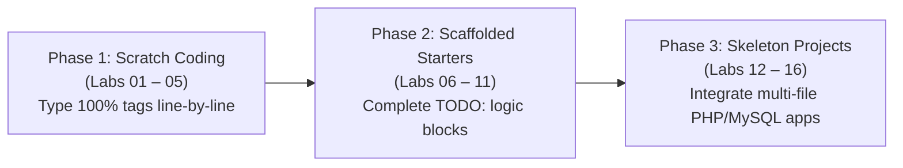

# 🧪 Practical Labs Index & Hands-On Lab Manuals

**Course Code:** `25SACS070P` (Web Technology Lab) \| `25BCC100P` (Cloud Computing Applications – I Lab)  
**Target Duration:** 16 Continuous 2-Hour Practical Lab Sessions (32 Hours Total)  
**Curriculum Coverage:** 100% Coverage across 30 SACS Experiments & 27 BCC Experiments (Synthesized into 13 Merged Experiments across 16 Lab Sessions).

---

## 🚀 Progressive Scaffolding & Fading Model Strategy

To ensure novice BCA students learn effectively without feeling overwhelmed, all 16 practical lab manuals adhere to the **Progressive Scaffolding & Fading Model**:

### 1. Phase 1: Scratch Coding (Labs 01 – 05)
* **Goal:** Build foundational muscle memory and HTML element syntax familiarity.
* **Student Activity:** Students receive blank `.html` files and code every single tag, heading, paragraph, list item, and table row line-by-line under direct instructor guidance.

### 2. Phase 2: Scaffolded Starter Templates (Labs 06 – 11)
* **Goal:** Master CSS styling, responsive layout components, JavaScript DOM manipulation, and event handling.
* **Student Activity:** Students receive pre-structured starter HTML/CSS templates containing explicit `<!-- TODO: Student Task X -->` comments guiding them where to write custom rules, selectors, and script logic.

### 3. Phase 3: Skeleton Project Architecture (Labs 12 – 16)
* **Goal:** Build full-stack dynamic web applications with PHP backend logic and MySQL database integration.
* **Student Activity:** Students work with modular project directories containing database connection files (`db_config.php`), CSS stylesheets, and PHP handlers, implementing complete user registration, authentication, and CRUD workflows.

---

## 📑 Complete 16 Practical Lab Manuals Index Table

| Lab # | Session Topic / Module Title | Curriculum Coverage Tag | Link to Guided Lab Manual |
|:---:|---|---|:---:|
| **Lab 01** | HTML Basics & Department Home Page | `[Covers: SACS Exp 1, BCC Exp 1]` | 🧪 [Lab 01 Manual](Lab-01_HTML-Basics-Department-Page.md) |
| **Lab 02** | Links, Images, Anchor Scrolling & Media | `[Covers: SACS Exp 2, 3, 4, 9 \| BCC Exp 2, 3, 4, 9]` | 🧪 [Lab 02 Manual](Lab-02_Links-Images-Scrolling-Media.md) |
| **Lab 03** | HTML Tables, Timetables & Frame Division | `[Covers: SACS Exp 5, 6, 8 \| BCC Exp 5, 6, 8]` | 🧪 [Lab 03 Manual](Lab-03_Tables-Timetable-Frames.md) |
| **Lab 04** | Semantic Page Layout using Div & Span | `[Covers: SACS Exp 7 \| BCC Exp 7]` | 🧪 [Lab 04 Manual](Lab-04_Div-Span-Semantic-Layout.md) |
| **Lab 05** | Inline CSS & Centralized External CSS Containers | `[Covers: SACS Exp 10, 11, 13 \| BCC Exp 10, 11]` | 🧪 [Lab 05 Manual](Lab-05_Inline-External-CSS-Containers.md) |
| **Lab 06** | HTML Forms, Input Controls & Fieldsets | `[Covers: SACS Exp 12, 14, 15, 16 \| BCC Exp 12, 13]` | 🧪 [Lab 06 Manual](Lab-06_HTML-Forms-Input-Controls.md) |
| **Lab 07** | Bootstrap Grid Layout & Shopping Store UI | `[Covers: SACS Exp 17 \| BCC Exp 14]` | 🧪 [Lab 07 Manual](Lab-07_Bootstrap-Grid-Shopping-UI.md) |
| **Lab 08** | Bootstrap Navbar & Carousel (Travel Portal UI) | `[Covers: SACS Exp 17 \| BCC Exp 14]` | 🧪 [Lab 08 Manual](Lab-08_Bootstrap-Navbar-Carousel.md) |
| **Lab 09** | JS Prompt Greetings & Timed Event Handlers | `[Covers: SACS Exp 18, 19, 21 \| BCC Exp 15, 16, 18]` | 🧪 [Lab 09 Manual](Lab-09_JS-Prompt-Greetings-Timed-Events.md) |
| **Lab 10** | Client-Side JavaScript Form Validation | `[Covers: SACS Exp 20 \| BCC Exp 17]` | 🧪 [Lab 10 Manual](Lab-10_JS-Form-Validation.md) |
| **Lab 11** | Dynamic DOM Manipulation & Style Toggling | `[Covers: SACS Exp 22, 23 \| BCC Exp 19, 20]` | 🧪 [Lab 11 Manual](Lab-11_JS-DOM-Manipulation-Toggling.md) |
| **Lab 12** | Department Web Application Project (Part 1) | `[Covers: SACS Exp 24, 25, 26 \| BCC Exp 21, 22, 23]` | 🧪 [Lab 12 Manual](Lab-12_Department-Website-Project-Part1.md) |
| **Lab 13** | E-Book Interface & Digital Library Portal (Part 2) | `[Covers: SACS Exp 24, 25, 26 \| BCC Exp 21, 22, 23]` | 🧪 [Lab 13 Manual](Lab-13_EBook-Interface-Project-Part2.md) |
| **Lab 14** | PHP Server-Side Form Handling (`$_GET` & `$_POST`) | `[Covers: SACS Exp 27, 28 \| BCC Exp 24, 25]` | 🧪 [Lab 14 Manual](Lab-14_PHP-Basics-GET-POST-Forms.md) |
| **Lab 15** | PHP & MySQL Database-Driven Dynamic Pages | `[Covers: SACS Exp 29, 30 \| BCC Exp 26, 27]` | 🧪 [Lab 15 Manual](Lab-15_PHP-MySQL-Database-Driven-Pages.md) |
| **Lab 16** | PHP MySQL User Registration & Login Authentication | `[Covers: SACS Exp 29, 30 \| BCC Exp 26, 27]` | 🧪 [Lab 16 Manual](Lab-16_PHP-MySQL-User-Login-Auth.md) |

---

## 🎯 Best Practices for Lab Execution

1. **Synchronized Timeline:** Always complete the associated **Theory Lecture Guide** (e.g., Class 12 on HTML Forms) before entering the lab for **Lab 06**.
2. **Code Ownership:** Avoid copy-pasting code blocks. Type out attributes and script logic to build muscle memory.
3. **Browser DevTools Debugging:** Open Chrome/Edge Developer Tools (`F12`) during every lab to inspect DOM element boxes, verify CSS rule specificity, and monitor the JavaScript Developer Console for errors.
4. **Server Environment Setup:** For Labs 12 through 16, ensure your local XAMPP/WAMP Apache web server and MySQL database service are running on `localhost`.
